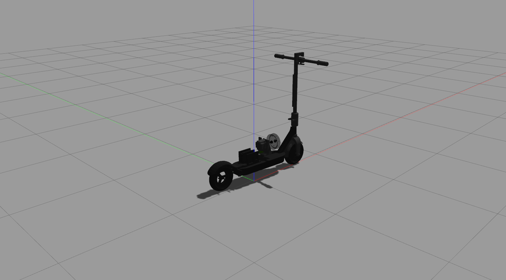

# Autonomous E-Scooter Simulation

A dynamics model for an autonomous e-scooter simulation. This project is built using ROS Noetic and Gazebo to simulate the behavior of an e-scooter, focusing on its dynamical systems.




<p align="center"><em>The e-scooter holding itself upright in Gazebo Classic 11.
The disc behind the deck is the reaction plate the balancing controller drives.</em></p>

## 📖 Table of Contents
- [About the Project](#about-the-project)
- [Getting Started](#getting-started)
  - [Prerequisites](#prerequisites)
  - [Installation](#installation)
- [Usage](#usage)
- [Contributing](#contributing)
- [Contact](#contact)

## About the Project

This repository contains the source code for simulating an autonomous e-scooter. It is intended to serve as a base for developing and testing control algorithms for scooter dynamics.

## Getting Started

Follow these instructions to get a copy of the project up and running on your local machine for development and testing purposes.

### Prerequisites

This project requires ROS Noetic and Gazebo.
*   [ROS Noetic](http://wiki.ros.org/noetic/Installation)
*   Gazebo (usually comes with the full desktop installation of ROS)

### Installation

1.  Create and build a catkin workspace:
    ```sh
    mkdir -p ~/catkin_ws/src
    cd ~/catkin_ws/
    catkin_make
    ```
2.  Clone the repository into your catkin workspace's `src` directory:
    ```sh
    cd ~/catkin_ws/src
    git clone https://github.com/sontypo/Autonomous_E-Scooter_Simulation.git
    ```
3.  Build the packages:
    ```sh
    cd ~/catkin_ws
    catkin_make
    ```
4.  Source the setup file to add the workspace to your ROS environment:
    ```sh
    source devel/setup.bash
    ```

## Usage

To launch the simulation, use the provided launch files. For example:
```sh
# Replace <package_name> and <launch_file> with your actual file names
roslaunch <package_name> <your_launch_file>.launch
```

## Contributing

Contributions are what make the open source community such an amazing place to learn, inspire, and create. Any contributions you make are **greatly appreciated**.

If you have a suggestion that would make this better, please fork the repo and create a pull request. You can also simply open an issue with the tag "enhancement".
Don't forget to give the project a star! Thanks again!

1.  Fork the Project
2.  Create your Feature Branch (`git checkout -b feature/AmazingFeature`)
3.  Commit your Changes (`git commit -m 'Add some AmazingFeature'`)
4.  Push to the Branch (`git push origin feature/AmazingFeature`)
5.  Open a Pull Request

## Contact

Saun Nguyen (Hong-Son) - son94227@gmail.com

Project Link: [https://github.com/sontypo/Autonomous_E-Scooter_Simulation](https://github.com/sontypo/Autonomous_E-Scooter_Simulation)
