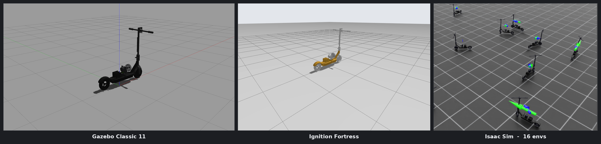

# Autonomous E-Scooter Simulation

A dynamics model for an autonomous e-scooter simulation, focused on its
dynamical systems and the balancing controller.


> This is the **`ros2-humble`** branch. The original ROS 1 Noetic / catkin
> version lives on `main`; see [docs/PORTING.md](docs/PORTING.md) for what
> changed and why.



<p align="center"><em>The same URDF across all three backends. Left and centre:
the reaction-plate balancing controller holding the scooter upright from a
standstill. Right: 16 Isaac Lab environments replaying a trained velocity-tracking
policy, with the commanded velocity drawn as an arrow over each scooter.</em></p>

## 📖 Table of Contents
- [About the Project](#about-the-project)
- [Getting Started](#getting-started)
  - [Prerequisites](#prerequisites)
  - [Build](#build)
- [Usage](#usage)
- [Interfaces](#interfaces)
- [Packages](#packages)
- [Contributing](#contributing)
- [Contact](#contact)

## About the Project

This repository simulates an autonomous, self-balancing e-scooter. The vehicle
steers with a handle-bar joint, drives through its front wheel, and keeps itself
upright with a reaction plate driven by a PD+ balancing law that runs on the IMU
roll feedback.

The same robot description drives two simulators:

| Backend | Engine | ros2_control system plugin |
| --- | --- | --- |
| `classic` (default) | Gazebo Classic 11 | `gazebo_ros2_control/GazeboSystem` |
| `ignition` | Ignition Gazebo Fortress | `ign_ros2_control/IgnitionSystem` |

Ignition Fortress is the Ignition version used because the ROS 2 Humble
`ros_gz_*` and `ign_ros2_control` binaries link against `ignition-gazebo6`,
even on machines that also have Gazebo Harmonic installed.

## Getting Started

### Prerequisites

* [ROS 2 Humble](https://docs.ros.org/en/humble/Installation.html)
* Gazebo Classic 11 **or** Ignition Gazebo Fortress (either is enough)

```bash
sudo apt install ros-humble-gazebo-ros-pkgs ros-humble-gazebo-ros2-control \
                 ros-humble-ros-gz-sim ros-humble-ros-gz-bridge ros-humble-ign-ros2-control \
                 ros-humble-ros2-control ros-humble-ros2-controllers ros-humble-xacro
```

### Build

```bash
mkdir -p ~/ros2_ws/src && cd ~/ros2_ws/src
git clone -b ros2-humble https://github.com/sontypo/Autonomous_E-Scooter_Simulation.git
cd ~/ros2_ws
rosdep install --from-paths src --ignore-src -r -y
colcon build --symlink-install
source install/setup.bash
```

The repository root is itself a colcon workspace, so cloning is optional — you
can `colcon build` straight from it.

## Usage

Launch the simulator, the controllers and the balancing node together:

```bash
ros2 launch escooter_simulation escooter_sim.launch.py
```

```bash
ros2 launch escooter_simulation escooter_sim.launch.py backend:=ignition
```

Drive it from the keyboard in a second terminal:

```bash
ros2 run escooter_dynamics teleop_escooter.py
```

Useful arguments (they work on `escooter_sim.launch.py` and on the two backend
launch files alike):

| Argument | Default | Meaning |
| --- | --- | --- |
| `backend` | `classic` | `classic` or `ignition` |
| `gui` | `true` | `false` runs the simulator headless |
| `dynamics` | `true` | `false` leaves the balancing node out |
| `rviz` | `false` | open RViz with the shipped configuration |
| `paused_model` | `false` | start the simulation paused |
| `namespace` | `/e_scooter` | robot namespace |
| `x_pos` `y_pos` `z_pos` `Roll` `Yaw` | `0 0 0.197 0.0243 0` | spawn pose |
| `world` | package world | world file for the selected backend |

Other entry points:

```bash
# The description in RViz only, with sliders for every joint
ros2 launch escooter_simulation display.launch.py

# The balancing node on its own (against a running simulation, or hardware)
ros2 launch escooter_dynamics escooter_dynamics.launch.py

# IMU orientation as roll/pitch/yaw on /euler_angles
ros2 run escooter_dynamics imu_to_euler.py
```

## Interfaces

The ROS 1 topic names are preserved.

| Topic | Type | Direction |
| --- | --- | --- |
| `/e_scooter/cmd_vel` | `geometry_msgs/Twist` | in — `linear.x` is the forward speed, `angular.z` the steering rate |
| `/imu` | `sensor_msgs/Imu` | in — roll feedback for the balancing law |
| `/e_scooter/joint_states` | `sensor_msgs/JointState` | in — from `joint_state_broadcaster` |
| `/e_scooter/odometry/calculated` | `nav_msgs/Odometry` | out — dead reckoning from the front wheel |
| `/twist` | `geometry_msgs/TwistWithCovarianceStamped` | out |
| `/e_scooter/handle_bar_chasis_joint_position_controller/commands` | `std_msgs/Float64MultiArray` | out — steering angle |
| `/e_scooter/rotational_plate_joint_effort_controller/commands` | `std_msgs/Float64MultiArray` | out — balancing torque |
| `/e_scooter/front_wheel_joint_velocity_controller/commands` | `std_msgs/Float64MultiArray` | out — traction |

ros2_control exposes the controller manager at `/e_scooter/controller_manager`:

```bash
ros2 control list_controllers -c /e_scooter/controller_manager
ros2 control list_hardware_interfaces -c /e_scooter/controller_manager
```

## Packages

| Package | Contents |
| --- | --- |
| `escooter_msgs` | `Joints`, `Pose`, `RPY` message definitions |
| `escooter_dynamics` | `Dynamics` (equations of motion, balancing law) and `Control` (ROS interface), the `escooter_dynamics_node` executable, parameters and the teleop utilities |
| `escooter_simulation` | xacro description, ros2_control configuration, worlds, RViz configuration and the bringup launch files |

The balancing loop holds the scooter within about a degree of upright on both
backends; [docs/PORTING.md](docs/PORTING.md) records what was wrong with it and
how the gains, the flywheel size and the momentum management were chosen.

Tunable model parameters (masses, centre of mass, PD+ gains, loop rate, joint
signs) live in
[`src/escooter_dynamics/params/escooter.yaml`](src/escooter_dynamics/params/escooter.yaml);
the controller definitions live in
[`src/escooter_simulation/config/escooter_controllers.yaml`](src/escooter_simulation/config/escooter_controllers.yaml).

## Contributing

Contributions are what make the open source community such an amazing place to
learn, inspire, and create. Any contributions you make are **greatly
appreciated**. Don't forget to give the project a star!

1. Fork the Project
2. Create your Feature Branch (`git checkout -b feature/AmazingFeature`)
3. Commit your Changes (`git commit -m 'Add some AmazingFeature'`)
4. Push to the Branch (`git push origin feature/AmazingFeature`)
5. Open a Pull Request

## Contact

Saun Nguyen (Hong-Son) - son94227@gmail.com

Project Link: [https://github.com/sontypo/Autonomous_E-Scooter_Simulation](https://github.com/sontypo/Autonomous_E-Scooter_Simulation)
